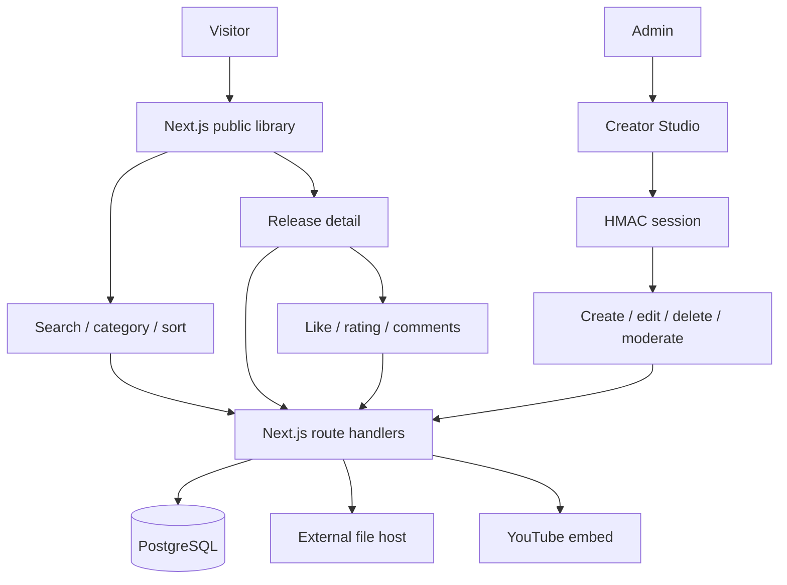

# Architecture

## Product structure

Aplikasi memisahkan pengalaman penemuan konten publik dari alur publikasi privat.

## Main routes

| Route | Purpose |
|---|---|
| `/` | Landing page, search, category filter, sorting, and release cards |
| `/library/[slug]` | Release detail, changelog, download, likes, rating, comments |
| `/admin` | Admin login, create/edit/delete releases, comment moderation |
| `GET /api/releases` | Public collection, query, category, and sort |
| `GET /api/releases/[slug]` | Public detail and approved comments |
| `POST /api/releases/[slug]/like` | Toggle anonymous visitor like |
| `POST /api/releases/[slug]/rating` | Create/update one rating per browser identity |
| `POST /api/releases/[slug]/comments` | Submit a public comment |
| `GET /api/download/[slug]` | Increment counter and redirect to file URL |
| `POST /api/admin/releases` | Create release |
| `PUT /api/admin/releases/[id]` | Update existing release metadata |
| `DELETE /api/admin/releases/[id]` | Delete release and related feedback |
| `/api/admin/*` | Admin session and comment moderation |

## Data model

- `releases`: content metadata, release version, external download URL, optional video/thumbnail, tags, changelog, featured state, and download counter.
- `release_likes`: one row per release and anonymous browser UUID.
- `release_ratings`: one rating (1–5) per release and anonymous browser UUID; later ratings update the existing row.
- `release_comments`: visitor name/body with `approved` or `hidden` state. Public API only exposes approved comments.

Interaction rows reference releases with `ON DELETE CASCADE`; deleting a release also removes its comments, likes, and ratings.

## Request and storage flow

1. Public UI requests the release collection from `/api/releases` with optional `q`, `category`, and `sort` parameters.
2. The API parameter-binds search and category filters. Sort order is selected from a fixed allowlist; it is not copied from raw SQL input.
3. Detail view requests the selected slug and approved comments.
4. A visitor cookie UUID is created for anonymous like/rating uniqueness. PostgreSQL unique constraints enforce one row per browser identity.
5. Admin create/edit/delete requests require the signed HttpOnly `ar_creator_admin` cookie.
6. Download route increments the counter and issues a redirect to the saved external file URL.

## Design decisions

- Next.js App Router serves pages and API routes in one project.
- PostgreSQL stores durable content and feedback.
- v0.2.0 uses a soft professional visual system: off-white canvas, white surfaces, muted sage accent, quiet borders, and responsive card layouts.
- The primary UI uses system font stacks and plain CSS; it does not require a hosted font request or a UI component framework.
- File binaries stay on external object/file hosting. This avoids relying on an ephemeral serverless filesystem.
- Anonymous browser IDs avoid mandatory accounts for basic feedback; they are not identity verification.
